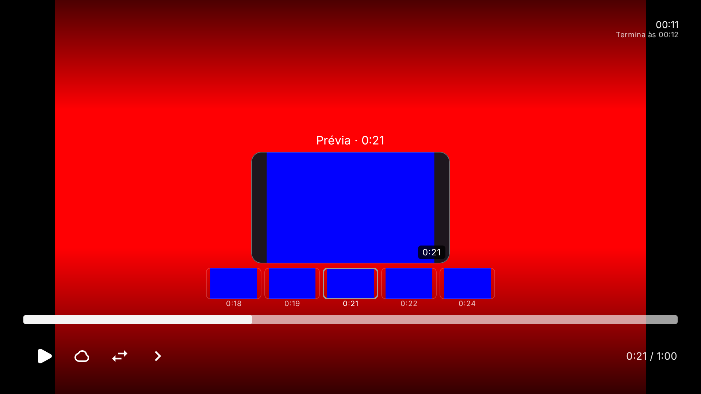

# Miniaturas e filmstrip no seek da TV

Estado: **implementado em `main`, com QA de componentes nativos nas configurações descritas abaixo**. A prova de todas as rotas do player e a investigação do timeout intermitente permanecem abertas. Não integra os APKs publicados da release 1.0.0. O incremento amplia `PlayerViewModel`, `PlayerScreen`, `PlayerProgressBar` e `PlayerTimelineFrames` existentes, mantendo Media3 e as ações de seek atuais.

## Comportamento

A posição pendente do controle remoto alimenta uma única fila de extração. O player principal recebe o seek pela ação existente de commit, no key-up; a prévia não o reposiciona. O foco continua na barra, e imagens/tiles não se tornam controles focáveis. Os incrementos de velocidade do D-pad existentes permanecem ativos.

O contexto inclui a conta/perfil e identidade local já resolvidos pelo repositório de momentos, obra, episódio, edição, URL, headers e duração. A composição revalida esse contexto antes de mostrar frames. Perder foco, abrir painéis/dialogs, trocar contexto ou sair do foreground encerra a sessão, cancela suas chamadas HTTP e libera o decoder. Sair do foreground também descarta a posição pendente, sem fazer seek no player principal.

Segurar o seek por 650 ms ativa o filmstrip. Repetições de posição não reiniciam esse timer. Se o usuário avança mais rápido que a decodificação, a fila pode apresentar uma amostra real da mesma sessão, com timestamp decodificado e aviso “Atualizando a cena…”, enquanto busca a posição mais recente. O destino da barra e o timestamp da imagem são distintos; não se atribui à imagem um horário inventado. Frames de outra sessão continuam rejeitados.

O filmstrip usa apenas frames distintos efetivamente decodificados, com no máximo cinco tiles. Durante movimento rápido, pode aproveitar amostras recentes em até 60 segundos ao redor do frame central; ao estabilizar, solicita os vizinhos próximos. Falha em um vizinho conserva o frame central válido. O cache RAM segue a quota existente, limitado a 4 MiB; isso não constitui um limite de memória total do decoder nem cache durável/offline.

No limite final, o pedido é normalizado para o último instante finito, sem inventar um frame no EOS. Áudio sem vídeo recebe fallback indisponível, sem poster disfarçado de cena. Loading, erro, recuperação e timestamps obsoletos têm estados separados.

## Apresentação e movimento

O visor de cena fica acima da barra, com imagem 16:9, destino solicitado e horário real do frame. Em tela compacta, usa imagem de 192 dp; nas demais, 272 dp. Durante seek nos controles completos, os detalhes textuais dão lugar ao visor, preservando a posição da barra e das ações inferiores. A paleta do player permanece escura para manter contraste, inclusive quando o restante do app usa tema claro.

O filmstrip e a entrada/saída do overlay usam a política de movimento do perfil; Reduzido e Desligado são respeitados. Não há blur, loop decorativo ou nova biblioteca de animação. A implementação utiliza as [transições nativas do Compose](https://developer.android.com/develop/ui/compose/animation/composables-modifiers) e preserva a [gestão de foco existente](https://developer.android.com/develop/ui/compose/touch-input/focus/change-focus-behavior).

## Prova disponível e pendente

Antes da integração visual, o commit `55cd5f33f27a1a63878614dfda8c182bc5a44915` passou em **215 testes selecionados e sete casos nativos por API 24/36**, incluindo cancelamento de corpo HTTP ativo, chamadas enfileiradas e recuperação. [Binding](telumia-tv-preview-lifecycle-r2-build-binding.json), [API 24](telumia-tv-preview-lifecycle-r2-api24-qa.json), [API 36](telumia-tv-preview-lifecycle-r2-api36-qa.json). A publicação em `main` acrescentou apenas a mesclagem do README da 1.0.0.

O novo incremento visual está no commit local `af115980da861b5b526005c7315745c6ac6f808d`. O primeiro build foi interrompido para incluir o respeito ao movimento no overlay de seek. O segundo perdeu seu runner/daemon antes de uma conclusão verificável. Essas tentativas foram preservadas; a recompilação atual usa o mesmo commit, com label `telumia-tv-timeline-ui-r3`.

O build `telumia-tv-timeline-ui-r3` passou em **222 testes selecionados**, sem falhas, erros ou skips; compilou os cinco APKs de desenvolvimento e o APK de instrumentação, com checkout limpo antes/depois. [Binding](telumia-tv-timeline-ui-r3-build-binding.json). Os **nove casos nativos de extração/seek vinculado passaram na API 36** com os mesmos APKs. [QA API 36](telumia-tv-timeline-ui-r3-api36-qa.json).

A suíte visual na API 36/1080p passou em **três dos quatro casos**. O caso de D-pad falhou ao exigir posição 6000 ms no vídeo local de seis segundos; o player efetivo reportou 5999 ms no limite final. A verificação deve tratar explicitamente esse limite e continuar exigindo posição exata para seek interior, isolamento antes do key-up e restauração de foco. Não se considera a suíte aprovada. A fila encerrou com falha e preservou a instrumentação; as configurações API 24, 720p e 4K desse incremento ainda não foram executadas. [Resultado visual](telumia-tv-timeline-surface-r3-api36-1080-qa.json). A melhoria permanece fora dos APKs 1.0.0 publicados.

A QA de componentes com AVC original gerado localmente não comprova todas as rotas da MainActivity, conta oficial autenticada, fontes remotas de terceiros, libmpv TV, HDR ou desempenho em TV física. A guarda atual de vídeo seekable usa o player Media3 efetivamente preparado; outros backends recebem fallback. Essas lacunas e a meta integral permanecem abertas.

## Continuação após o primeiro gate

O commit `f890570a46e3558f1f267005bc76d7702531a287` corrigiu a fixture de D-pad: vídeo original de 30 segundos, aplicação cumulativa do delta, seek interior exato (2 → 12 segundos), limite final explícito (29999 ms) e retorno exato (20 segundos). O build `telumia-tv-timeline-ui-r4` passou novamente nos **222 testes selecionados**, com cinco APKs e instrumentação, e nos **nove casos de extração API 36**. [Binding](telumia-tv-timeline-ui-r4-build-binding.json), [extração](telumia-tv-timeline-ui-r4-api36-qa.json).

A primeira suíte visual r4 teve timeout de extração no caso Reduzido; o caso D-pad passou. Uma repetição sem alterar fonte/APKs passou nos quatro casos API 36/1080p, mas a inspeção da captura Completo encontrou uma imagem branca. Portanto, o resultado da instrumentação não constitui aprovação visual. Na API 24, oito dos nove casos passaram: a fixture de seek contínuo encerrou o movimento após 1,8 s, antes de obter uma amostra no decoder frio. Não há aprovação dessa configuração. As tentativas anteriores permanecem preservadas.

O commit local `ddd55a9924c8bc58295f17fe55a462bac7d39f9b` mantém a amostra real da mesma sessão durante novas repetições, com estado provisório e timestamp decodificado, evitando substituir cada amostra por Loading. A captura passa a exigir pixels reais do frame azul e do viewport escuro antes de salvar. O teste de movimento cobre a preparação fria dentro de uma janela limitada e continua o seek por mais 1,8 s após a primeira amostra, sem aguardar soltar o controle para contar um frame. Os resultados do build `telumia-tv-timeline-ui-r5` e dos gates posteriores estão registrados na seção seguinte.

## Resultados do incremento r5 e investigação atual

O build r5 terminou em 13/10/2026, com **222 testes selecionados, zero falhas/erros/skips**, cinco APKs e instrumentação. [Binding](telumia-tv-timeline-ui-r5-build-binding.json). Os **nove casos de extração passaram em cada uma das APIs 24 e 36**: [API 24](telumia-tv-timeline-ui-r5-api24-qa.json), [API 36](telumia-tv-timeline-ui-r5-api36-qa.json).

Os quatro casos visuais passaram nas configurações [API 24/1080p](telumia-tv-timeline-surface-r5-api24-1080-qa.json), [API 36/1080p](telumia-tv-timeline-surface-r5-api36-1080-qa.json) e [API 36/720p](telumia-tv-timeline-surface-r5-api36-720-qa.json). As seis capturas foram inspecionadas e preservadas em `docs/evidence/telumia-tv-timeline-ui-r5/`: frame real vermelho/azul, timestamps, filmstrip e geometria visíveis nos modos Completo e Reduzido. O caso de D-pad usa o player principal real pausado e confere seek interior, limite final e retorno de foco. A API 24 usa o locale padrão do emulador, sem declarar tradução pt-BR validada nessa configuração.

Na [tentativa r5 API 36/4K](telumia-tv-timeline-surface-r5-api36-2160-qa.json), três casos passaram e um expirou ao decodificar a fixture, antes de montar os estados de loading/erro. Essa tentativa não aprovou o conjunto 4K. Não se aumentou o timeout para mascarar a falha.

A hipótese de pendência ao repetir a posição de um decoder já Ready foi testada no commit `b41763e63f955e0305e632bd01cf248ef64431bc`. O teste observa o ExoPlayer secundário real, solicita novamente 500/4500 ms e verifica timestamp, pixels e pausa; **os dez casos nativos passaram na API 36**. [Build](telumia-tv-frame-repeat-red-r1-build-binding.json), [QA](telumia-tv-frame-repeat-red-r1-api36-qa.json). Essa execução não reproduziu a hipótese, portanto não motivou alteração do extractor. O nome histórico da label `red` identifica a tentativa de reprodução, não uma falha observada.

O commit `4a90855db1473f8ae3a85fe30e1e9125cc70075c` acrescenta somente diagnóstico à instrumentação: se a extração expirar, registra posição solicitada, estado, buffer, duração e contadores do decoder da fixture, sem URLs/headers. Seu build também passou nos 222 testes selecionados. [Binding](telumia-tv-frame-diagnostics-r1-build-binding.json).

A [nova execução API 36/4K](telumia-tv-frame-diagnostics-r1-surface-api36-2160-qa.json) passou nos quatro casos e gerou duas capturas inspecionadas, preservadas em `docs/evidence/telumia-tv-frame-diagnostics-r1/api36-2160/`. O APK universal de produção manteve o SHA-256 `b0e41fda2306bddcff2d3dce4fc26dc4a0d1f985adf1a82ca650977508b4e693` do r5; o diff entre os commits limita-se à instrumentação. Assim, as quatro configurações tiveram execução aprovada dos componentes com o mesmo APK de aplicação. **A repetição não demonstrou uma correção para o timeout anterior**, que permanece preservado para investigação.

O código foi publicado em `main` no commit `6b8376661b23d5ecf9ed9a6b565ef69fffdc53a6`, que acrescenta somente README sobre o código compilado em `4a90855d`. A integração visual permanece fora da release 1.0.0; investigação, todas as rotas do player, conta oficial e hardware continuam abertas.

## Perfil de seek adaptado à memória

No commit `1ede6b307f977df11860ccf4d96ace98297c40e8`, a integração de timeline existente passou a respeitar `TvPerformanceProfile`: baixa RAM mantém o frame central e não faz as quatro decodificações vizinhas do filmstrip; perfil equilibrado habilita o filmstrip após 1,2 s; alta capacidade após 650 ms. O cache RAM de frames fica limitado a 1/2/4 MiB, respectivamente, e continua subordinado aos budgets ativos de thumbnails/filmstrip.

`TvPerformanceProfileTest` verifica os três limites e atrasos. No run `39338632273`, passaram os testes selecionados, `compileFullDebugAndroidTestKotlin` e `assembleFullDebug`; a suíte nativa foi compilada, mas não executada. [Registro e APK temporário](telumia-tv-low-resource-r2-ci.json). Esta mudança adapta carga especulativa por tier; não prova desempenho físico, heap total, FPS ou latência de seek na TV Box do usuário. A release publicada 1.0.0 permanece inalterada.

No commit `13b7966f212b1c3ee061e7c70ad9c3f56d4c3270`, cada perfil limita a cadência entre extrações repetidas a 300/180/120 ms (baixa RAM/equilibrado/alta capacidade). A primeira captura de cada sessão permanece imediata; a fila conflada descarta pedidos intermediários obsoletos e conserva o mais recente. O run `39339978937` passou nos testes de política, compilou a instrumentação Android e montou `fullDebug`; não executou os testes instrumentados nem mediu hardware físico. [Registro e APK](telumia-tv-low-resource-r3-ci.json).

## Fluxo real pelo aplicativo

O build `telumia-tv-main-player-flow-r1`, fonte `11a0c96cf063a131a7410c730d210878de6c5ff8`, passou nos 222 testes selecionados e preservou os seis APKs. O APK universal conserva o hash do r5: o incremento acrescenta somente uma fixture de instrumentação para exportar vídeo original. [Binding](telumia-tv-main-player-flow-r1-build-binding.json).

Em uma AVD nova API 36/1080p, sem contas ou dados copiados, a QA manual percorreu onboarding convidado, Home, configurações e instalação de um addon temporário pelo campo de URL existente. O provider local serviu exclusivamente um vídeo AVC SDR original de 60 segundos. A rota existente de stream da MainActivity buscou a fonte; a seleção abriu o PlayerScreen e PlayerViewModel reais com Media3. Não foi criada uma rota alternativa de player.

Com o vídeo pausado, D-pad Up focou a timeline. Segurar Right por sete segundos mostrou thumbnail real e filmstrip de cinco frames; a captura mostra o player principal vermelho e a prévia azul antes do key-up. Soltar confirmou 21 segundos, fechou o overlay e manteve o foco na timeline. Back retornou à fonte original com foco restaurado. [Registro manual e hashes das capturas](telumia-tv-main-player-flow-r1-qa.json).

A primeira instrumentação da fixture terminou com um ANR de início de processo durante verificação DEX pelo ART, antes de executar o teste. A segunda passou em um caso/3,828 segundos; os logs anteriores foram preservados. O início da MainActivity levou 15,923 segundos e o seguinte 12,049 segundos nesse ambiente debug frio. Não se declara correção do ANR, início rápido ou resolução do timeout de extração anterior. A aprovação manual cobre esta única rota convidada AVC SDR em 1080p; conta oficial, demais rotas, HDR e hardware continuam pendentes. As capturas publicadas contêm somente vídeo original e UI de QA; QR de login e logs brutos permanecem privados.
